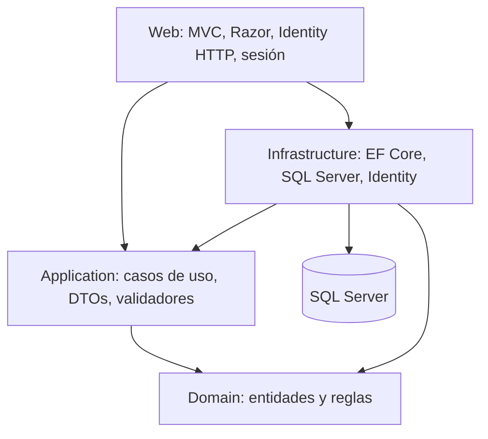

# BISUTERIAS DANN’S

Tienda ASP.NET Core MVC en .NET 10: catálogo público, personalización, carrito de sesión, pedidos e inventario, cuentas de clientes y panel administrativo. Se mantiene la arquitectura original de cuatro capas.

## Requisitos

- .NET SDK 10 (verificado en esta revisión con 10.0.402).
- SQL Server accesible; las pruebas aceptan `BISUTERIA_TEST_CONNECTION` y crean su propia base temporal.
- HTTPS para cookies de autenticación y carrito.
- Node.js y Edge/Playwright solo para las comprobaciones visuales.

## Configurar y ejecutar

Desde la raíz:

```powershell
dotnet restore Bisuteria.slnx
dotnet dev-certs https --trust
dotnet user-secrets set "ConnectionStrings:DefaultConnection" "<cadena de conexión de desarrollo>" --project src/Bisuteria.Web
dotnet user-secrets set "PublicBaseUrl" "https://localhost:7083" --project src/Bisuteria.Web
dotnet run --project src/Bisuteria.Web --launch-profile https
```

Abre `https://localhost:7083`. La configuración incluida usa `localhost`, base `BisuteriaDb` y autenticación integrada. `TrustServerCertificate=True` es para desarrollo; en despliegue configura un certificado SQL válido, el dominio público y `AllowedHosts` restringido.

**Antes del primer arranque en desarrollo**, revisa la conexión: por defecto se aplican las migraciones y se insertan roles/configuración inicial. Para impedir esa inicialización usa `$env:Database__Initialize = "false"`; en ese caso la base ya debe estar preparada. En producción, aplica migraciones como artefacto controlado y luego deja `Database__Initialize=true` para el seed; el proceso web nunca aplica migraciones automáticamente.

Para crear la primera cuenta técnica, configura `InitialDeveloper:Email` y `InitialDeveloper:Password` con user-secrets en desarrollo o variables `InitialDeveloper__Email` y `InitialDeveloper__Password` en producción. El arranque crea el rol Developer solo si aún no existe una cuenta Developer y obliga a cambiar la clave inicial antes de entrar al panel. Owner y Developer no requieren verificación TOTP; los clientes pueden activarla voluntariamente desde su perfil. No conviertas cuentas del antiguo rol Admin automáticamente. En producción, una instalación sin Developer ni credenciales iniciales se detiene con un mensaje claro.

El catálogo es público. `/Admin` verifica permisos de `Developer`, `Owner` y `Operator`; registrarse asigna exclusivamente `Customer`. `/Account/Profile` y los pedidos personales requieren autenticación.

## Pagos y entrega

No se habilita ningún pago por defecto. Activa únicamente lo confirmado por la tienda:

```powershell
dotnet user-secrets set "Payments:EnabledMethods:0" "CashOnDelivery" --project src/Bisuteria.Web
```

La transferencia se habilita desde **Admin > Configuración > Pagos** una vez cargados los datos bancarios. `Payments:EnabledMethods` solo configura los métodos técnicos disponibles, como pago contra entrega; `BankTransfer` no se habilita desde user-secrets.

`Card` no está integrado y el checkout lo rechaza. Estos métodos crean un pago pendiente; **no procesan cobros bancarios**. El administrador actualiza su estado tras verificarlo. No se inventaron cuentas bancarias ni credenciales. Con la lista vacía el checkout informa que no hay un método disponible.

Las tarifas se configuran por ciudad y sector en **Admin > Envíos > Zonas y tarifas**. El checkout vuelve a consultar la zona activa en el servidor; el precio que mande el navegador se ignora. Mientras falte una cotización, el pedido queda con el envío pendiente y la tienda debe fijar el costo desde el pedido antes de que se acepte el pago. Retiro en tienda no cobra envío. `ShippingCost` y `PostalCode` se conservan para compatibilidad e historial; ya no fijan el precio de nuevos pedidos y el código postal no se muestra. La promoción `FreeShippingThresholdEnabled` permanece desactivada hasta que la propietaria confirme las condiciones comerciales.

La cobertura habilitada es Manta y Jaramijó, Manabí. La migración agrega una opción de sector por confirmar para cada ciudad, sin crear tarifas ni sectores ficticios. La propietaria debe agregar/editar zonas desde el panel antes de operar; cualquier zona con tarifa, gratuidad o plazo debe coincidir con la política real.

## Correo y avisos de pedidos

Configura privadamente `Smtp:Host`, `Smtp:Port` (587 por defecto), `Smtp:UseSsl` (true), `Smtp:From`, `Smtp:User` y `Smtp:Password`. Sus equivalentes de entorno usan doble guion bajo, por ejemplo `Smtp__Password`. Configura también `PublicBaseUrl` con el origen HTTPS real para los enlaces de recuperación.

En `Development`, con el SMTP desactivado, el transporte guarda capturas locales `.eml` en `src/Bisuteria.Web/App_Data/MailDrop`; esas capturas cuentan como procesadas, no prueban entrega a Gmail y no se reenvían al habilitar SMTP. El envío real en desarrollo requiere `Smtp:Enabled=true` además de la configuración SMTP completa. Los avisos de compra usan el correo de contacto de `SiteSetting`; el remitente SMTP es una configuración independiente. El estado del Developer muestra si faltan claves y aclara que la entrega final aún debe comprobarse en la bandeja del proveedor. Nunca imprimas enlaces ni tokens en la terminal. Las pruebas usan un doble de correo y no envían mensajes reales.

Después de cambiar user-secrets, reinicia el proceso local para recargar la configuración. Los pedidos anteriores que ya quedaron procesados en capturas locales no se reenvían automáticamente. El mensaje de WhatsApp es opcional: se abre preparado para revisión y el cliente debe pulsar Enviar.

## Arquitectura



- `Domain`: entidades y enumeraciones; no depende de MVC ni de EF.
- `Application`: contratos, validadores, servicios, precios y mapeos explícitos.
- `Infrastructure`: persistencia, transacciones, migración, identidad e inicialización.
- `Web`: controladores públicos, área Admin protegida, vistas, modelos de formulario y cargas de imágenes.
- `tests/Bisuteria.Tests`: integración HTTP y SQL real aislado, además de validaciones.
- `tests/visual`: comprobación reproducible del HTML renderizado con Edge.
- `docs`: informe y decisiones de auditoría. `audit/`: evidencia local y respaldos, ignorados por Git.

No se necesita licencia de AutoMapper: sus mapeos se sustituyeron por funciones tipadas y expresiones LINQ. Se conservan DTOs relacionados juntos por responsabilidad.

## Reglas que protegen la compra

El pedido vuelve a leer productos, categorías, precios, personalizaciones y envío dentro de una transacción serializable. En esa misma transacción guarda pedido, pago, uso de cupón y movimientos de stock. Agrupa cantidades por producto para impedir que dos variantes consuman más stock del disponible. Una cancelación repone existencias una sola vez.

La edición administrativa conserva `OriginalStock`: si hubo un cambio desde que se abrió el formulario, exige recargar. Cada ajuste registra un movimiento. Las imágenes se verifican por contenido, formato, tamaño y resolución, y se vuelven a codificar a JPEG. Una operación fallida descarta únicamente archivos nuevos de esa solicitud; las imágenes históricas se conservan para no romper referencias.

`Price` es el importe cobrado. `ComparePrice` es una referencia anterior opcional y debe superar `Price`; ambos admiten hasta dos decimales. No se cambian importes históricos.

## Compilar y probar

```powershell
dotnet build Bisuteria.slnx -c Debug
dotnet build Bisuteria.slnx -c Release
dotnet test Bisuteria.slnx --logger "trx;LogFileName=tests.trx" --results-directory audit/test-results
dotnet list Bisuteria.slnx package --vulnerable --include-transitive
node --check src/Bisuteria.Web/wwwroot/js/site.js
node --check tests/visual/browser-audit.cjs
```

Las pruebas requieren permiso para crear/eliminar una base **temporal** `BisuteriaAudit_<GUID>` en `localhost`. Verifican su nombre antes de migrar y antes de eliminarla; no usan `BisuteriaDb`. No son pruebas con EF InMemory. El doble SMTP no envía mensajes. Los correos `example.test` y contraseñas en la fixture son datos ficticios aislados.

Para la inspección HTML rápida:

```powershell
cd tests/visual
npm install
npm run check
```

Para la auditoría de navegador real, con Node.js y SQL Server de pruebas disponibles:

```powershell
npm ci --prefix tests/visual
npx --prefix tests/visual playwright install chromium
dotnet build Bisuteria.slnx -c Release
$env:BROWSER_AUDIT = "1"
$env:BROWSER_AUDIT_PHASE = "before"
dotnet test tests/Bisuteria.Tests/Bisuteria.Tests.csproj -c Release --no-build --filter Category=Browser
Remove-Item Env:BROWSER_AUDIT, Env:BROWSER_AUDIT_PHASE
```

La medición final usa `BROWSER_AUDIT_PHASE="after"`. Playwright recorre las rutas reales en 360, 768 y 1366 px, ejecuta axe, prueba flujos con datos ficticios y genera Lighthouse móvil; guarda capturas y JSON/HTML de Lighthouse en `audit/browser/before` y `audit/browser/after`. La fixture confirma que utiliza `BisuteriaAudit_<GUID>` y elimina esa base temporal. La prueba se omite en la suite normal salvo que `BROWSER_AUDIT=1`. axe y Lighthouse aportan diagnóstico, no certificación WCAG ni garantía de rendimiento en producción.

## Estado de la revisión integral (22 de octubre de 2026)

El historial de revisiones anteriores conserva resultados de las ramas en que se generó. La matriz de permisos y el modelo de invitaciones están en [la documentación de roles y cuentas](docs/fase-2-3-roles-y-cuentas.md) y [la matriz de permisos](docs/matriz-permisos.md). Los resultados de la revisión de cobertura, avisos y cambios de octubre 22 están en [el informe de fases actual](docs/revision-fases-negocio-2026-10-22.md). [El informe integral anterior](docs/revision-integral-final.md) describe otra rama y fecha; no representa esta revisión.

SMTP real, cobros bancarios y despliegue requieren configuración y comprobación externas. Consulta [la preparación del despliegue](docs/despliegue.md) y [las funciones parciales](docs/funciones-pendientes.md).

## Mantenimiento y respaldo

Versiona código, migraciones, documentación y pruebas. `.gitignore` excluye `bin`, `obj`, dependencias, logs, secretos, resultados y uploads. Respalda **por separado** SQL Server y `wwwroot/img/uploads`; no borres archivos históricos suponiendo que no se usan. `audit/source-before.zip` y `audit/source-before-final-2026-10-04.zip` son respaldos de código, no copias de seguridad de SQL. El proyecto utiliza Git para versionar el código; los respaldos y los datos comerciales se conservan por separado.

En desarrollo, el carrito usa memoria; producción exige `Session__Provider=SqlServer` y guarda el carrito en la tabla `DistributedCache` de la migración nueva. Varias instancias pueden compartir esas sesiones si usan la misma base y claves de Data Protection persistentes. Los contadores de rate limiting aún son locales por proceso; el proxy confiable debe estar configurado antes de desplegar. No se configuró ni certificó un despliegue productivo.

## Pruebas portables y producción

En PowerShell, establece `$env:BISUTERIA_TEST_CONNECTION` con la conexión de un servidor de pruebas; Linux usa `export BISUTERIA_TEST_CONNECTION=...`. No copies credenciales al repositorio. La fixture sustituye siempre el catálogo por `BisuteriaAudit_<GUID>` y verifica su nombre antes de migrar/eliminar. Ejecuta `dotnet test Bisuteria.slnx -c Release`. El workflow `.github/workflows/verify.yml` prepara SQL Server temporal con contraseña aleatoria y bloquea dependencias vulnerables.

Producción requiere `AllowedHosts`, `PublicBaseUrl` HTTPS, `DataProtection:KeysPath` persistente con permisos restringidos, `Database:ApplyMigrations=false` y `Session:Provider=SqlServer`. Configura `ReverseProxy:KnownProxies:0` solo para un proxy confiable. Después de aplicar un script de migración revisado, deja `Database:Initialize=true` para seed de roles/configuración y la cuenta inicial. Confirmación de correo: `Identity:RequireConfirmedEmail=true`, tras comprobar SMTP. `/health` devuelve disponibilidad de SQL sin detalles internos. JSON logging se configura con `Logging:LogLevel`.

El carrito está en memoria y requiere almacenamiento compartido para varias instancias. El correo usa EmailOutbox persistente en SQL con reservas y reintentos; consulta [operación de correo](docs/ampliacion-fase5-correo.md). Consulta los informes `docs/fase-*.md` para resultados concretos; no constituyen una certificación de producción.

## Panel y seguridad

El Developer cuenta con vistas separadas para salud del sistema, auditoría y matriz de roles. El Owner y el Operator reciben permisos explícitos; la cuenta histórica `Admin` no se eleva automáticamente. La suite de las fases anteriores y la rama actual tienen resultados distintos: consulta el informe final antes de reutilizar cifras antiguas.

**Hay nuevas migraciones aditivas.** Antes de ejecutar esta versión sobre tu base habitual, respalda y revisa las migraciones con un procedimiento explícito. Las verificaciones de desarrollo usan bases temporales; producción se detiene si `Database:ApplyMigrations=true`. Aplica el SQL durante un despliegue controlado.

La búsqueda global del Admin encuentra pedidos por número/cliente y productos por nombre/SKU. La meta mensual se configura en Configuración. El calendario usa Guayaquil y excluye pedidos cancelados. Los importes representan pedidos, no confirmación bancaria de cobros. Productos activos muestra el estado actual porque no existe un historial completo para calcular su variación.
