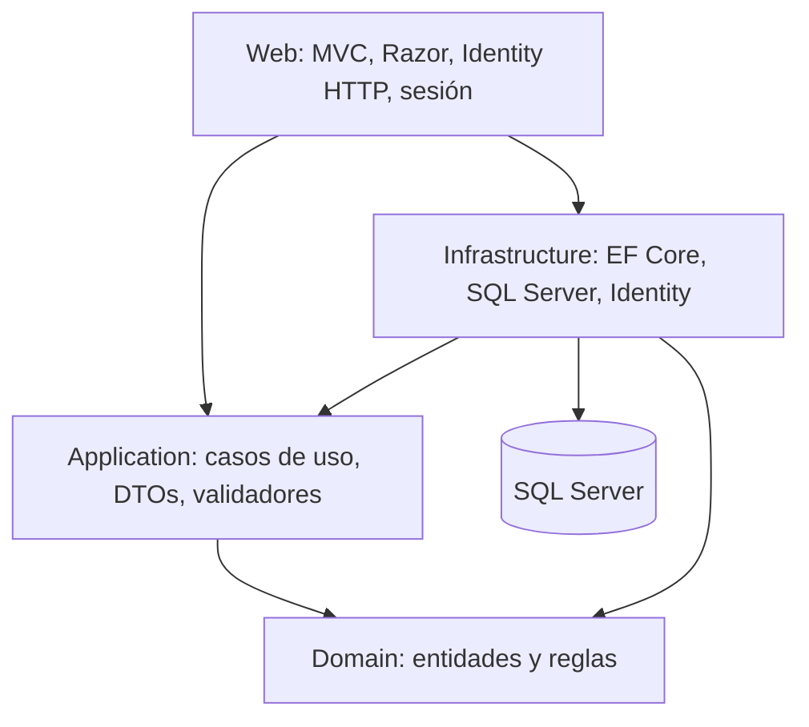

# BISUTERIAS DANN’S

Tienda ASP.NET Core MVC en .NET 10: catálogo público, personalización, carrito de sesión, pedidos e inventario, cuentas de clientes y panel administrativo. Se mantiene la arquitectura original de cuatro capas.

## Requisitos

- .NET SDK 10; comprobado con SDK 10.0.401.
- SQL Server accesible; las pruebas aceptan `BISUTERIA_TEST_CONNECTION` y crean su propia base temporal.
- HTTPS para cookies de autenticación y carrito.
- Node.js y Edge/Playwright solo para las comprobaciones visuales.

## Configurar y ejecutar

Desde la raíz:

```powershell
dotnet restore Bisuteria.slnx
dotnet dev-certs https --trust
dotnet user-secrets set "ConnectionStrings:DefaultConnection" "<cadena de conexión de desarrollo>" --project src/Bisuteria.Web
dotnet user-secrets set "PublicBaseUrl" "https://localhost:7083" --project src/Bisuteria.Web
dotnet run --project src/Bisuteria.Web --launch-profile https
```

Abre `https://localhost:7083`. La configuración incluida usa `localhost`, base `BisuteriaDb` y autenticación integrada. `TrustServerCertificate=True` es para desarrollo; en despliegue configura un certificado SQL válido, el dominio público y `AllowedHosts` restringido.

**Antes del primer arranque**, revisa la conexión: por defecto se aplica la migración existente y se insertan roles/configuración inicial. Para impedir esa inicialización usa `$env:Database__Initialize = "false"`; en ese caso la base ya debe estar preparada. No ejecutes migraciones sobre una base real sin respaldo y revisión.

Para crear el primer administrador, configura de forma privada `InitialAdmin:Email` y `InitialAdmin:Password` mediante user-secrets o variables `InitialAdmin__Email`/`InitialAdmin__Password`. El inicializador solo crea esa cuenta si no existe. Retira la contraseña inicial de la configuración después. No existe contraseña de administrador en el código.

El catálogo es público. `/Admin` exige el rol `Admin`; registrarse asigna exclusivamente `Customer`. `/Account/Profile` y los pedidos personales requieren autenticación.

## Pagos y entrega

No se habilita ningún pago por defecto. Activa únicamente lo confirmado por la tienda:

```powershell
dotnet user-secrets set "Payments:EnabledMethods:0" "CashOnDelivery" --project src/Bisuteria.Web
# Solo si la tienda confirmó transferencia:
# dotnet user-secrets set "Payments:EnabledMethods:1" "BankTransfer" --project src/Bisuteria.Web
```

`Card` no está integrado y el checkout lo rechaza. Estos métodos crean un pago pendiente; **no procesan cobros bancarios**. El administrador actualiza su estado tras verificarlo. No se inventaron cuentas bancarias ni credenciales. Con la lista vacía el checkout informa que no hay un método disponible.

`ShippingCost` y `FreeShippingThreshold` se administran en Configuración. Los importes utilizan punto decimal. Retiro/entrega local tienen envío cero. Antes de operar valida que las opciones ofrecidas coincidan con las condiciones reales del negocio.

## Correo de recuperación

Configura privadamente `Smtp:Host`, `Smtp:Port` (587 por defecto), `Smtp:UseSsl` (true), `Smtp:From`, `Smtp:Username` y `Smtp:Password`. Sus equivalentes de entorno usan doble guion bajo, por ejemplo `Smtp__Password`. Configura también `PublicBaseUrl` con el origen HTTPS real para los enlaces de recuperación.

Sin SMTP, desarrollo registra solo un aviso; **no imprime el enlace ni el token**. En producción la falta de configuración produce un error controlado y se mantiene el mensaje público genérico. Las pruebas capturan el enlace con un doble de correo y verifican el token y su uso único. **El envío real SMTP está pendiente de configuración y prueba externa.**

## Arquitectura



- `Domain`: entidades y enumeraciones; no depende de MVC ni de EF.
- `Application`: contratos, validadores, servicios, precios y mapeos explícitos.
- `Infrastructure`: persistencia, transacciones, migración, identidad e inicialización.
- `Web`: controladores públicos, área Admin protegida, vistas, modelos de formulario y cargas de imágenes.
- `tests/Bisuteria.Tests`: integración HTTP y SQL real aislado, además de validaciones.
- `tests/visual`: comprobación reproducible del HTML renderizado con Edge.
- `docs`: informe y decisiones de auditoría. `audit/`: evidencia local y respaldos, ignorados por Git.

No se necesita licencia de AutoMapper: sus mapeos se sustituyeron por funciones tipadas y expresiones LINQ. Se conservan DTOs relacionados juntos por responsabilidad.

## Reglas que protegen la compra

El pedido vuelve a leer productos, categorías, precios, personalizaciones y envío dentro de una transacción serializable. En esa misma transacción guarda pedido, pago, uso de cupón y movimientos de stock. Agrupa cantidades por producto para impedir que dos variantes consuman más stock del disponible. Una cancelación repone existencias una sola vez.

La edición administrativa conserva `OriginalStock`: si hubo un cambio desde que se abrió el formulario, exige recargar. Cada ajuste registra un movimiento. Las imágenes se verifican por contenido, formato, tamaño y resolución, y se vuelven a codificar a JPEG. Una operación fallida descarta únicamente archivos nuevos de esa solicitud; las imágenes históricas se conservan para no romper referencias.

`Price` es el importe cobrado. `ComparePrice` es una referencia anterior opcional y debe superar `Price`; ambos admiten hasta dos decimales. No se cambian importes históricos.

## Compilar y probar

```powershell
dotnet build Bisuteria.slnx -c Debug
dotnet build Bisuteria.slnx -c Release
dotnet test Bisuteria.slnx --logger "trx;LogFileName=tests.trx" --results-directory audit/test-results
dotnet list Bisuteria.slnx package --vulnerable --include-transitive
node --check src/Bisuteria.Web/wwwroot/js/site.js
```

Las pruebas requieren permiso para crear/eliminar una base **temporal** `BisuteriaAudit_<GUID>` en `localhost`. Verifican su nombre antes de migrar y antes de eliminarla; no usan `BisuteriaDb`. No son pruebas con EF InMemory. El doble SMTP no envía mensajes. Los correos `example.test` y contraseñas en la fixture son datos ficticios aislados.

Para las capturas, primero ejecuta satisfactoriamente `ExportRenderedPagesForResponsiveChecks` (incluida en la suite). Después:

```powershell
cd tests/visual
npm install
npm run check
```

Usa Edge instalado o define `BROWSER_PATH` con el ejecutable de Chromium compatible. El script comprueba 14 páginas en 390, 768 y 1440 px; guarda `audit/screenshots` y `audit/visual-results.json`. Falla ante desbordamiento de página, imágenes rotas o errores JavaScript. Las tablas pueden desplazarse dentro de su contenedor. Es una inspección del HTML generado, no un reemplazo de las pruebas HTTP ni una certificación en dispositivos físicos.

## Estado de la auditoría (11 de octubre de 2026)

Consulta [el resultado vigente](docs/resultado-auditoria.md). Las cinco fases terminaron con **134 pruebas aprobadas**, compilación Release sin errores ni advertencias y 42 comprobaciones visuales más 5 interacciones aprobadas. [GitHub Actions verificó compilación, pruebas y dependencias en Linux con SQL temporal](https://github.com/xXxLuisxXx/pagina-web-bisuteria-danns/actions/runs/38194505198). El informe `docs/auditoria-final.md` conserva la revisión histórica anterior.

SMTP real, cobros bancarios y despliegue requieren configuración y comprobación externas. Consulta [la preparación del despliegue](docs/despliegue.md) y [las funciones parciales](docs/funciones-pendientes.md).

## Mantenimiento y respaldo

Versiona código, migraciones, documentación y pruebas. `.gitignore` excluye `bin`, `obj`, dependencias, logs, secretos, resultados y uploads. Respalda **por separado** SQL Server y `wwwroot/img/uploads`; no borres archivos históricos suponiendo que no se usan. `audit/source-before.zip` y `audit/source-before-final-2026-10-04.zip` son respaldos de código, no copias de seguridad de SQL. El proyecto utiliza Git para versionar el código; los respaldos y los datos comerciales se conservan por separado.

Sesión y limitación de solicitudes son locales a un proceso. Un despliegue con varias instancias necesita caché distribuida, claves de Data Protection compartidas y configuración de proxy confiable. No se configuró ni certificó un despliegue productivo.

## Pruebas portables y producción

En PowerShell, establece `$env:BISUTERIA_TEST_CONNECTION` con la conexión de un servidor de pruebas; Linux usa `export BISUTERIA_TEST_CONNECTION=...`. No copies credenciales al repositorio. La fixture sustituye siempre el catálogo por `BisuteriaAudit_<GUID>` y verifica su nombre antes de migrar/eliminar. Ejecuta `dotnet test Bisuteria.slnx -c Release`. El workflow `.github/workflows/verify.yml` prepara SQL Server temporal con contraseña aleatoria y bloquea dependencias vulnerables.

Producción requiere `AllowedHosts`, `PublicBaseUrl` HTTPS y `DataProtection:KeysPath` persistente con permisos restringidos. Configura `ReverseProxy:KnownProxies:0` solo para un proxy confiable. Confirmación de correo: `Identity:RequireConfirmedEmail=true`, tras comprobar SMTP. `/health` devuelve disponibilidad de SQL sin detalles internos. JSON logging se configura con `Logging:LogLevel`. Conserva `Database:Initialize=false` en producción y aplica migraciones revisadas durante el despliegue.

El carrito y la cola SMTP están en memoria: un despliegue con varias instancias requiere almacenamiento compartido/durable. Consulta los informes `docs/fase-*.md` para resultados concretos; no constituyen una certificación de producción.
